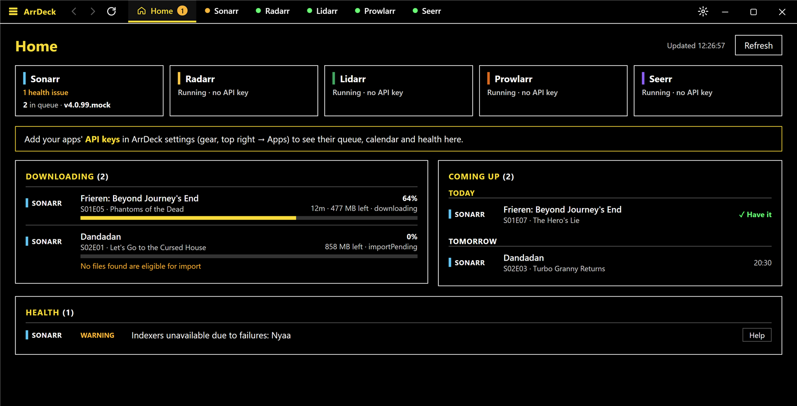
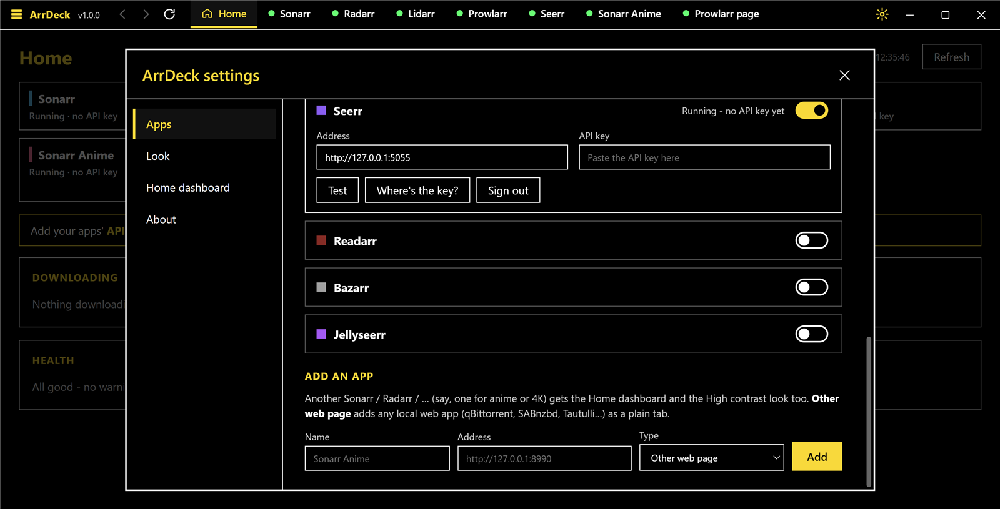

# ArrDeck

**Sonarr, Radarr, Lidarr, Prowlarr and Seerr in one window** — a small portable Windows app with a tab per app, a Home dashboard (downloads, what's coming up, health warnings from all of them) and a black, white and gold High contrast look.



## Features

- **One window, a tab per app.** Sonarr, Radarr, Lidarr, Prowlarr and Seerr out of the box; Readarr, Bazarr and Jellyseerr one switch away. A status dot on every tab: green running, amber warnings, red errors or not answering.
- **Your sign-ins stay.** Every app has its own saved session: sign in once in its tab and ArrDeck remembers it. Each app also remembers the page you were on and its own zoom.
- **Home dashboard.** Sub-tabs for an Overview and the full Downloads (with progress and import problems), Coming up (episodes, movies, albums), Missing, Health, Requests and Alerts lists — from every app at once. Click anything to jump to it in its app.
- **Missing on Home.** Each app's Wanted → Missing, newest first, with Search per item and Search all missing per app (asks first).
- **Seerr requests on Home.** What's waiting for approval, with Approve / Decline, and what was requested lately (with its status). Optional alert for each new request.
- **High contrast look, built in.** Black, white and gold inside Sonarr, Radarr, Lidarr, Prowlarr, Readarr, Seerr, Jellyseerr and Bazarr — no browser extension needed. Can be switched off.
- **Ignores the Windows theme.** A Windows contrast theme or light mode doesn't wash out the apps: ArrDeck always shows its own colours.
- **Finds your API keys.** *Find my API keys* reads them from the apps' own settings files on this PC (`config.xml`, Seerr's `settings.json`, Bazarr's `config.yaml` — Windows installs or a Docker `appdata` folder) and matches them to your tabs by app and port. No copy-pasting.
- **Tray and alerts.** Minimise (or ✕) to the tray, start with Windows, pin it to the taskbar. Alerts when a download is done, a new health warning or error shows up, or an app stops answering: on Home (Recent alerts), as a red dot on the tray icon, and as Windows notifications (with the optional Start menu entry).
- **Queue buttons on Home.** Search again, Grab now (skip a delay) and Remove — or Remove and find another (blocklists the release) — right from the dashboard.
- **Your own tabs, your order.** Add a second Sonarr / Radarr (anime, 4K…) with the dashboard and the look, or any local web app (qBittorrent, SABnzbd, Tautulli…) as a plain tab. Drag tabs to reorder them, rename any tab.
- **Fully portable.** One `ArrDeck.exe`; settings and sign-ins live in `ArrDeck-data` next to it. No installer, nothing in AppData (unless you switch on the optional Start menu entry).
- **Updates itself.** When a new version is out, the title bar shows *Update x.y.z*: one click downloads it, checks its SHA-256 and swaps the .exe. Nothing installs without a click.



## Download

Get `ArrDeck.exe` from the [latest release](https://github.com/Farathim89/arrdeck/releases/latest), put it in a folder of its own and start it. Windows SmartScreen may warn about an unknown app the first time (the .exe isn't code-signed): *More info → Run anyway*.

## First steps

1. ArrDeck expects the apps on this PC at their usual ports (`127.0.0.1:8989`, `7878`, `8686`, `9696`, `5055`). Different address? **Settings (gear, top right) → Apps**.
2. Sign in to each app in its tab, as you would in a browser.
3. For the Home dashboard and alerts, click **Find my API keys** in *Settings → Apps* (add the folder your apps keep their settings in with *Also look in a folder…* if they're somewhere else) — or paste a key by hand (*Where's the key?* opens the right page in each app). Keys are stored encrypted with Windows' own data protection, only on this PC.

## Keys

| Keys | Does |
| --- | --- |
| Ctrl+1 … Ctrl+9 | Go to tab 1 … 9 |
| Ctrl+Tab / Ctrl+Shift+Tab | Next / previous tab |
| F5 or Ctrl+R | Reload |
| Alt+Left / Alt+Right (mouse side buttons) | Back / forward |
| Alt+Home | The app's start page |
| Ctrl + / Ctrl - / Ctrl 0 | Zoom |
| F11 | Full screen |
| Ctrl+, | Settings |

## Build from source

Needs [Node.js](https://nodejs.org/) 20 or newer.

```
npm install
npm start          # run it
npm run dist       # build dist\ArrDeck.exe
```

The High contrast styles are in `themes/` as Stylus user styles (`.user.css`); ArrDeck strips the Stylus wrapper and injects the rules itself, so they also work in a browser with Stylus.

## License

GPL-3.0-or-later. ArrDeck is not affiliated with Sonarr, Radarr, Lidarr, Prowlarr, Readarr, Bazarr, Seerr or Jellyseerr.
